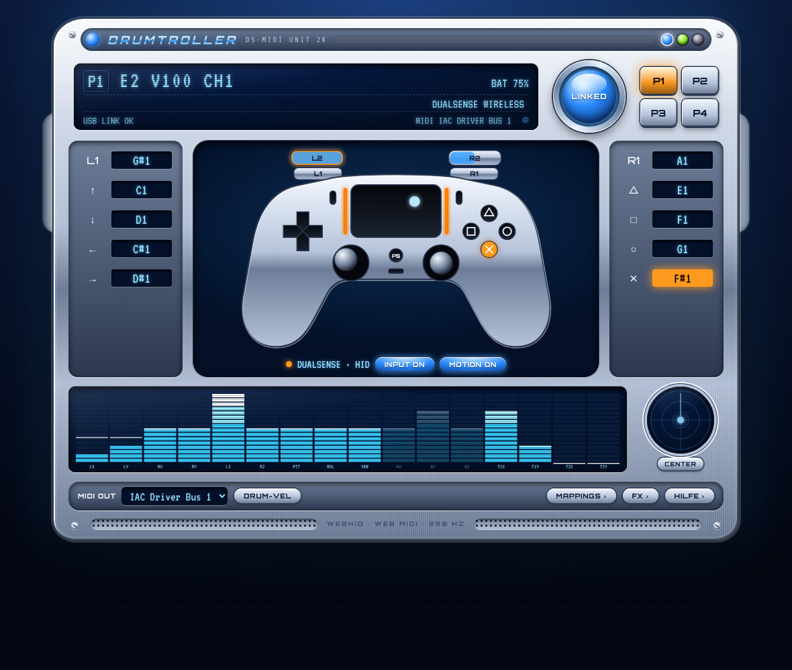

# Drumtroller



DualSense → MIDI direkt im Browser. Seite öffnen, Controller anschließen und loslegen. Alle Inputs des PS5-Controllers werden zu MIDI für Ableton, Bitwig, Logic, FL & Co.:

| Input | MIDI (Preset P1) |
| --- | --- |
| D-Pad, △ □ ○ ✕, L1/R1, L2/R2 (Klick), L3/R3, Options, Touchpad-Klick | Noten C1–D#2 (Drum-Rack-Layout) |
| Touchpad Finger 1 / 2 (Berühren) | Noten E2 / F2 |
| Touchpad Finger 1 / 2 X/Y | CC 102–105 |
| Sticks X/Y | CC 20–23 |
| L2/R2 Druck (analog) | CC 24 / 25 |
| Gyro Pitch / Roll / Yaw | CC 26 / 27 / 28 |
| Beschleunigung X/Y/Z | CC 29–31 (standardmäßig aus) |

P2–P4 haben dasselbe Layout auf MIDI-Kanal 2–4. Alles lässt sich im **MAPPINGS**-Fenster ändern: Note, CC, Pitchbend, Kanal, Kurve, Bereich und Invertierung. Die Presets werden im Browser gespeichert und lassen sich als JSON exportieren.

## Schnellstart

1. **Chrome oder Edge** am Desktop öffnen (Windows, macOS, Linux, ChromeOS). Firefox und Safari können kein WebHID.
2. DualSense per USB oder Bluetooth koppeln. Tasten und Sticks funktionieren sofort.
3. **CONNECT** drücken und den Controller auswählen. Damit sind Gyro, Touchpad, Akku, Lightbar, Rumble und adaptive Trigger aktiv. Ab dann verbindet er sich automatisch.
4. MIDI-Port einrichten:
   - **macOS:** Audio-MIDI-Setup → Fenster → MIDI-Studio → *IAC-Treiber* → „Gerät ist online“
   - **Windows:** [loopMIDI](https://www.tobias-erichsen.de/software/loopmidi.html) installieren und einen Port anlegen
5. Den Port bei **MIDI OUT** wählen und in der DAW als MIDI-Eingang aktivieren.

### System-Tasten

- **PS**: nächstes Preset (Lightbar-Farbe und Player-LEDs zeigen es an)
- **Mute**: Motion an/aus (die Mute-LED leuchtet, wenn Motion aus ist)
- **Create**: Gyro zentrieren

### Tipps

- **SOLO** im Mapping-Fenster: Nur dieses Input sendet. So kann man in der DAW per MIDI-Learn sauber zuweisen, ohne dass das Gyro dazwischenfunkt.
- **DRUM-VEL**: Die Velocity kommt aus der Bewegung. Mit dem Controller „in die Luft schlagen“ und dabei die Taste drücken, dann spielt ein harter Schlag lauter.
- Mit WebHID läuft die App auch weiter, wenn das Browserfenster im Hintergrund ist und die DAW vorne liegt.

## Entwicklung

```bash
npm install
npm run dev      # http://localhost:5173
npm test         # Vitest: HID-Parser, CRC, Output-Reports, Mapping-Engine
npm run build    # → dist/
```

WebHID und Web MIDI brauchen einen sicheren Kontext, also `https://` oder `localhost`.
Die Datei `.github/workflows/deploy.yml` deployt bei jedem Push auf `main` nach GitHub Pages. Dazu einmal in den Repo-Settings unter **Pages → Source: GitHub Actions** auswählen.

### Aufbau

```
src/input/dualsense-report.ts  HID-Report-Parser (USB 0x01 / BT 0x31), Kalibrierung, Output-Reports
src/input/dualsense-hid.ts     WebHID-Verbindung, Auto-Reconnect, Output-Queue
src/input/gamepad-fallback.ts  Gamepad-API-Fallback ohne Berechtigung
src/input/motion.ts            Gyro + Accel → Pitch/Roll/Yaw (Komplementärfilter)
src/mapping/                   Presets und Mapping-Engine (State → MIDI)
src/midi/midi-out.ts           Web MIDI Output, Notennamen (C3 = 60)
src/ui/                        Controller-SVG, Analyzer, Mapping-Editor
src/styles/                    Y2K-Skin-Look (Chrome Blue, Toxic Green, Classic Amp)
```
